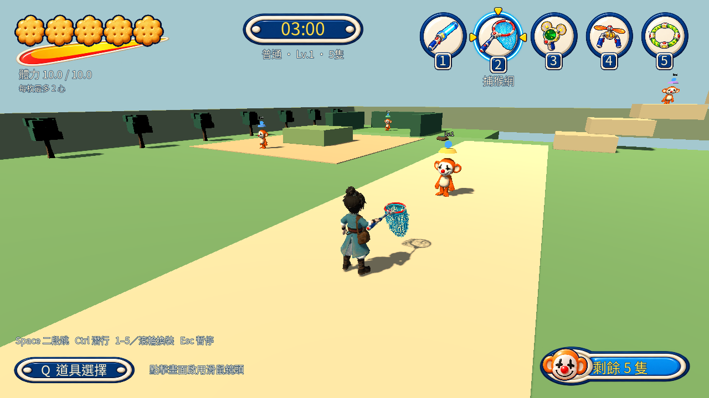

# 巨箱5.0 · Gersang

以 Godot 製作的戰術 RPG 原型，結合等角探索、傭兵編隊、即時戰鬥、轉珠戰鬥與 3D 捕猴挑戰。

A Godot tactical RPG prototype with isometric exploration, party management, RTS battles, puzzle combat, and 3D monkey-catching challenges.



## 遊戲內容

- 在原生地圖探索、接觸怪物隊伍、穿越城鎮與地城入口。
- 管理主角與傭兵的裝備、技能、物品、經驗及受傷狀態。
- 在即時戰鬥中選取隊伍、下達移動與攻擊指令，使用角色技能。
- 挑戰轉珠怪物、神抄之塔、彩虹神殿動作戰鬥及不同難度的捕猴關卡。
- 保存探索進度與戰鬥結果；保留音效、角色語音及繁體中文字體。

本專案仍在開發。各關卡平衡、手機實機表現及完整回歸有待持續驗證。

## 在本機執行

1. 安裝 **Godot 4.7.1**，使用 **Compatibility** 渲染器。
2. 複製此倉庫。

   ```sh
   git clone https://github.com/Furionk/gersang.git
   ```

3. 在 Godot 專案管理員匯入 `gersang/project.godot`，等候首次資源匯入完成。
4. 按 **F5** 啟動正式遊戲。世界及戰場場景的 **F6** 是隔離試玩。

已有 Godot 命令列工具時，也可執行：

```sh
godot --editor --path gersang
godot --path gersang
```

## 公開版素材

`art/music/` 整個目錄及其 `.import` 檔案均不納入 Git。沒有背景音樂時，探索、戰鬥、結果結算及存檔仍可運作；音效與角色語音保留。作者本機的音樂檔不會被刪除。若自行加入有合法使用權的音樂，可依 [BGM 契約](specs/background_music.md) 的路徑設定。

EmacEArt 村莊原始素材及其依賴場景也不公開。未安裝時，捕猴入口自動使用內附庭園場景，保留難度設定及怪物數量。庭園的地形與村莊不同，難度體驗會有差異。來源、安裝方式及限制見 [可選素材說明](docs/optional_assets.md)。

公開倉庫不包含 `.godot/`、`artifacts/`、`build/`、本機憑證、生成快取或玩家存檔。

## 開發與內容編輯

原生 `.tres`、`.tscn`、TileMapLayer 及 Inspector 是內容資料的權威。不要重跑一次性建置腳本覆寫現有場景。

- [內容製作指南](docs/content_authoring_guide.md)：兵種、技能、SpriteSheet、入口與地形。
- [專案結構](docs/architecture/project_map.md) 與 [資源政策](docs/architecture/resource_policy.md)。
- [現行規格](specs/index.md)、[設計決策](specs/decisions.md) 與 [文件索引](docs/index.md)。
- 使用 AI 協作前先讀 [AGENTS.md](AGENTS.md)。

PowerShell 主題查詢：

```powershell
./tools/project_context.ps1 -Query '兵種'
./tools/project_context.ps1 -Verify
```

## 驗證公開 checkout

先匯入資源，再執行下列場景。將 `godot` 換成你的 Godot 執行檔路徑。

```sh
godot --headless --editor --path . --import
godot --headless --path . res://tests/background_music_suite.tscn
godot --headless --path . res://tests/public_checkout_suite.tscn
godot --headless --path . res://tests/entry_persistence_suite.tscn
```

測試使用隔離存檔。BGM 測試在公開 checkout 驗證無音樂流程；作者本機有六首曲目時，另驗證播放及交叉淡化。村莊專項測試需要未包含的可選素材。歷史完整回歸仍有既有失敗，專項通過不代表全部玩法或平衡已驗收。

## 匯出 Web

在 Godot 開啟 **Project → Tools → Web Export Studio**，先設定自己的輸出目錄及 Godot 執行檔，再使用 `Web Demo No BGM` 預設。作者本機的磁碟路徑需要按你的環境調整。

插件提供 SHA-256 分塊驗證、下載重試、版本管理及快取。網站部署需要完整的匯出結果；本倉庫不直接作為 GitHub Pages 網站。

詳見 [Web Export Studio 說明](addons/web_export/README.md)。

## 作者與素材權利

作者：[Furion Mashiou / Furionk](https://github.com/Furionk)。

Original project code and project-owned work are licensed under the [MIT License](LICENSE). You may use, modify, distribute, and sell MIT-covered work, including in commercial and closed-source projects, while retaining the required notice. Third-party and separately sourced assets retain their own terms; see [credits and third-party notices](CREDITS.md).
