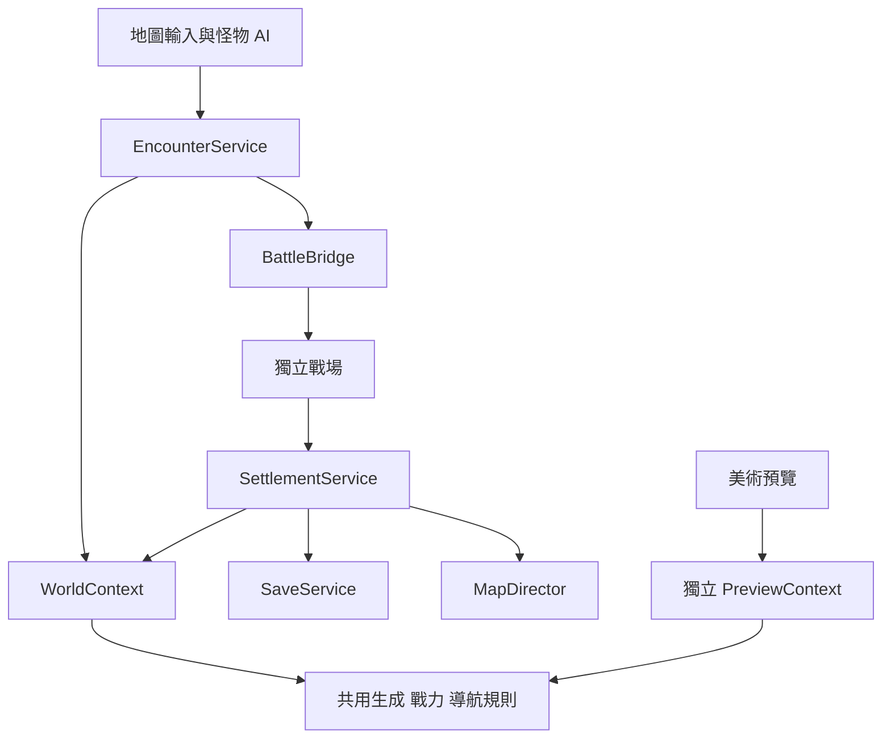
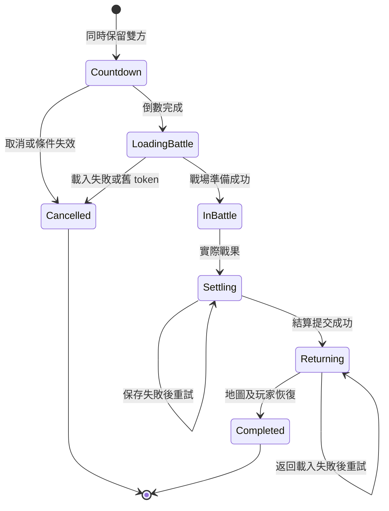

以 Godot 製作巨商式新遊戲的第一個可玩版本：大地圖怪隊遊走、玩家與怪隊戰力顯示、主動及被動遭遇、獨立戰鬥與回圖重生，以及美術可直接操作的區域、城鎮和地城配置工具。

本計畫是開發規格。以下生命週期、測試數值和戰力公式是本案版本一的設計決定，不代表原版巨商的內部公式或現行資料。先完成一個示例地區，再擴展四國內容。日期：2026 年 10 月 8 日。

## 01 交付範圍與技術基線

### 第一版完成後應能操作的流程

玩家在城鎮整備，離城後看見遊走怪隊及其戰力。點擊被動怪，或被主動怪接近，進入倒數與獨立戰鬥。戰果只結算一次，返回正確地圖；其餘怪隊保留，被消耗怪隊的槽位依規則重生。玩家可進入兩層地城、上下樓、存檔並重開。美術能以圖形工具建立另一個合法怪物區、城鎮安全區及地城入口。

| 決策 | 版本一基線 |
| - | - |
| 引擎 | 新專案以 Godot 4.6.x API 為基線，Phase 0 鎖定實際 patch 版本並記錄。已有專案先遵循現有版本，核對等價 API；不為套用計畫自行升級。 |
| 語言 | Typed GDScript。若現有專案已有統一語言規則，先保留其規則並做對應。 |
| 畫面 | 2D 世界與 2D 戰場；先採正交邏輯平面，角色與建築可用斜視素材。真正等角座標轉換、3D 地形另期處理。 |
| 單位 | 位置與半徑統一使用 Godot 2D world units，時間在資料層使用毫秒。Inspector 明示單位；若顯示公尺，必須經同一個 world_units_per_meter 換算。 |
| 執行模式 | 單機，本機 WorldSession 為唯一權威；保留命令入口，不加入 RPC 或 MMO 伺服器。 |
| 地圖導航 | WorldNavigationService 封裝 AStarGrid2D，第一版只有一個導航後端。美術畫多邊形，後端轉成受限制的網格。 |
| 世界分區 | 一個外部大地圖、一個簡單城內場景、兩層地城；每張地圖有獨立 map_id。一次啟用一張探索地圖。 |
| 怪隊 | 地圖一個代表物件對應一支實際隊伍；版本一每場遭遇一支敵隊，資料以陣列保留擴充位置。 |
| 內容 | 臨時或既有素材、一組基本戰場；完整四國主角、二轉、裝備庫與技能平衡不屬本期。 |
| 編輯器 | Godot 原生地形／素材擺放，加自製 world_authoring 外掛。 |

不納入第一版：多人連線與 PVP、附近怪隊加入同場戰鬥、完整貿易／航海／稅收經濟、背景模擬全部國家、離線重生、戰鬥中途續戰、同時維護 2D 與 3D 工具。這些項目不應阻塞本期，也不先建立空殼子系統。

## 02 必須保持的不變條件

1. 代表外觀不是額外一名戰鬥成員。

2. 怪隊出生時就固定成員、等級、個體 ID 和永久配置；查看、倒數、入場均不重新抽隊。

3. 世界名稱牌、隊伍資訊和戰鬥快照使用同一個 PowerCalculator；隊伍戰力是上陣成員戰力總和。

4. 每個玩家隊伍或怪隊同時最多屬於一個未完成遭遇。

5. 倒數、載入及戰鬥中的怪隊仍占出生槽；只有正式結算消耗怪隊後才開始補位倒數。

6. 同一 encounter_id 最多提交一次戰果。獎勵、消耗、怪隊與槽位更新，以及提交記錄，屬於同一份狀態變更。

7. 重新載入地圖只重建呈現節點，不能清空現有世界資料再抽一批怪。

8. Runtime 不修改共用的 UnitDefinition、PartyTemplate 或 SpawnProfile。

9. 編輯器預覽有獨立 WorldContext、時鐘、亂數與存檔替身，不操作正式 WorldSession。

10. 出生點及每段移動軌跡均符合該模式的合法區域；只驗終點不算通過。

## 03 資料層與識別規則

### 編輯資料

以自訂 Resource 保存可重用規則，場景保存物件位置與區域形狀。Godot 的 Resource 可在 Inspector 編輯與序列化，且相同資源可被多處共用；因此共用定義與個體執行狀態必須分開。[Godot 4.6 Resources](https://docs.godotengine.org/en/4.6/tutorials/scripting/resources.html)

| 類型 | 必要欄位與用途 |
| - | - |
| UnitDefinition | definition_id、content_revision、display_name、外觀引用、最大 HP／MP、基本攻擊數值、base_power、level_power_growth。戰力評分與實際傷害數值分開。 |
| PartyTemplate | template_id、display_name、representative_scene、MemberRule 陣列。每條 MemberRule 指定 definition_id、數量／等級範圍及永久配置。 |
| SpawnProfile | 有權重的 PartyTemplate 清單、target_party_count、respawn_min_ms／max_ms、encounter_rules、movement_profile_id、arena_pool。 |
| EncounterRules | passive／active、interaction_radius、aggro_radius、engage_radius、countdown_ms、chase_timeout_ms、return_protection_ms、reengage_cooldown_ms。 |
| PolygonDomain | 一個簡單外框與多個排除孔洞，座標位於擁有節點的 local space。第一版拒絕自交、重疊洞、巢狀洞與接觸外框的洞。 |
| WorldMapDefinition | map_id、map_kind、display_name、場景引用、content_version、safe_return_map_id＋safe_return_entry_id。 |
| TownDefinition | town_id、類型、interior_map_id、respawn_entry_id、設施模板 ID；此期不執行人口及稅收模擬。 |
| ArenaDefinition | arena_id、場景引用、敵我出生標記、隊伍容量、返回流程所需設定。 |
| MapRegistry | map_id 對應場景資源；大地圖、城內、地城樓層均有獨立 ID。 |

### 可保存的執行資料

純資料物件使用明確的 to_dict／from_dict 或等價序列化，不保存 Node、RID、Timer、Callable 或場景內 NodePath。

| 類型 | 必要欄位 |
| - | - |
| UnitInstance | unit_id、definition_id、definition_revision、level、永久裝備配置、current_hp／mp、resolved_stats、rated_power。 |
| PartyInstance | party_id、template_id、display_name、representative_id、deployed_units、reserve_units、total_power、roster_revision。 |
| WorldPartyState | party_id、map_id、habitat_id、slot_id、position、life_state、movement_state、encounter_id、行為計時與返巢資訊。 |
| PlayerWorldState | party_id、map_id、position、facing、life_state、encounter_id、safe_return_map_id／entry_id；玩家當前所在地的唯一來源。 |
| SpawnSlotState | slot_id、habitat_id、state、party_id、generation_index、respawn_due_ms、可選 pending_party。 |
| MapRuntimeState | map_id、已初始化標記、怪隊與槽位、玩家離開位置、地圖事件狀態。 |
| EncounterSession | encounter_id、initiator、狀態、參戰 party_ids、保留 token、倒數 deadline、戰前快照、返回位置與場景 ID。 |
| WorldState | player_party、player_world_state、maps、world_time_ms、ID counter、各 RNG stream state、active_encounter、applied_results、player_progress。 |

識別分工：definition_id／template_id 識別內容；map_id＋habitat_id／entry_id 識別作者配置；party_id／unit_id／encounter_id 識別執行個體。顯示名稱絕不能作 key。兩隊「禁衛隊」必須可以同時存在、分別點選及保存。

IDs 由獨立 IdAllocator 產生，與抽怪亂數分離。存檔保留 allocator counter；新怪重生得到新 party_id 和新 unit_id，但使用原 slot_id。Godot 資源 UID 僅處理資源檔引用；地圖內入口 ID 仍由本案管理。

編輯器複製區域或入口時產生新的作者 ID；複製城鎮組合時，組內連接也要重新映射。場景重新開啟不得重新產生既有 ID。驗證器檢查重複 ID。

## 04 戰力與固定驗收資料

第一版採可替換的 authored_rating_v1，先建立一致性，不用總戰力反推 HP 或傷害。

```text
unit_power = max(0,
    base_power
    + level_power_growth * (level - 1)
    + sum(permanent_equipment_power_bonus))

party_power = sum(deployed_units.rated_power)
```

- 評分是編隊的配置強度，不隨受傷程度、短期 buff 或戰鬥內臨時召喚上下跳動。

- 後備單位不計入；所有可上陣單位的評分皆經同一服務計算。

- 升級、永久裝備變更或調整編隊時遞增 roster_revision，重新計算後發出 party_changed。

- 從保留開始，到遭遇完成或取消之前，鎖定編隊、升級套用及裝備修改。

- World UI 讀取已解析的 PartySummary；禁止在 UI 另寫加總規則。

- 戰鬥不因評分較高而自動勝利，仍由實際 HP、攻擊與操作決定。

- 初版裝備可為空配置；公式接口保留永久加成，但不開發完整裝備系統。

以下成員配法是本案測試 fixture，總數沿用使用者提供的例子，不是原版成員表。

| 顯示名稱 | 測試編成 | 預期戰力 |
| - | - | - |
| Furion | 主角 1 × 8,400，加護衛 2 × 5,000 | 18,400 |
| 禁衛隊 | 禁衛 6 × 7,200，加弓手 2 × 10,800 | 64,800 |
| 禁衛隊 | 禁衛 8 × 7,200，加弓手 2 × 10,800，加隊長 1 × 12,000 | 91,200 |
| 野鴨 | 野鴨 4 × 80 | 320 |
| 巫女 | 巫女 4 × 320 | 1,280 |

怪隊生成順序：選模板、建立完整成員、計算戰力、尋找合法出生點、占用槽位、建立代表節點。位置取樣失敗時保留同一次 pending_party 或停止該次生成；重試位置不能每幀重新抽編成。

## 05 Runtime 模組與依賴

WorldSession 作為 Autoload 持有正式 WorldContext；Autoload 可在場景切換間保持資料，但關閉程式後的保存仍由 SaveService 負責。[Godot 4.6 Autoload](https://docs.godotengine.org/en/4.6/tutorials/scripting/singletons_autoload.html)

| 模組 | 責任與邊界 |
| - | - |
| WorldContext | 擁有 WorldState、Clock、RNG、服務依賴；runtime 與 preview 各有一份。 |
| WorldSession | 正式 context 的生命週期、讀檔與新遊戲入口；不包辦所有系統邏輯。 |
| PartyBuilder | 將唯讀模板和 RNG 轉成獨立 PartyInstance。 |
| PowerCalculator | 解析單位及隊伍評分，產生一致的 PartySummary。 |
| SpawnService | 管理槽位、生成序號、重生 deadline 和有上限的重試。 |
| WorldNavigationService | 合法出生格、連通區與完整路徑查詢；封裝唯一導航後端。 |
| MonsterBrain | Idle／Wander／Chase／Return 決策；透過服務提出遭遇意圖。 |
| EncounterService | 驗證、同時保留雙方、倒數、取消及啟動戰鬥；唯一可建立遭遇的入口。 |
| BattleBridge | 建立 BattleContext，切換測試／正式戰場，接收 BattleResult。 |
| SettlementService | 驗證戰果、建立一次性結算變更、交由保存流程提交。 |
| MapDirector | 載入探索場景、依現有 MapRuntimeState 重建呈現、定位到達點與恢復控制。 |
| SaveService | 版本化完整快照、上一版備份、讀檔驗證與中斷恢復。 |
| WorldAuthoringPlugin | 修改作者資料、預覽及驗證，不直接驅動正式 WorldSession。 |



服務依賴由 context 注入；共用生成、戰力、幾何和導航程式不得硬連正式 Autoload。若 @tool 腳本需呼叫共用邏輯，優先以不依賴 SceneTree 的靜態函式或適當的工具腳本提供，避免編輯器執行時意外啟動 runtime。

### 需要固定的接口契約

下列是接口摘要，不是可直接執行的腳本。

```text
PartyBuilder.build(template_id, rng) -> PartyInstance
PowerCalculator.make_summary(party) -> PartySummary
WorldNavigationService.sample_spawn(habitat_id, profile_id, rng) -> SpawnPointResult
WorldNavigationService.find_path(map_id, habitat_id, mode, from, to) -> PathResult
EncounterService.try_begin(player_party_id, enemy_party_id, initiator) -> EncounterStartResult
EncounterService.cancel(encounter_id, reason) -> CancelResult
BattleBridge.start(context: BattleContext) -> StartBattleResult
SettlementService.apply(result: BattleResult) -> SettlementReceipt
MapDirector.enter(map_id, entry_id_or_return_position) -> MapEnterResult
SaveService.commit(candidate_state) -> SaveCommitResult
```

回傳失敗必須有原因碼；UI 只能發命令、讀 summary、接收結果訊號，不可直接修改 life_state、slot 或獎勵。

## 06 區域出生 遊走 追擊與時間

### 作者節點

- WorldMap2D：根節點，引用 WorldMapDefinition。

- WalkableArea2D：一個或多個可通行 domain，指定 movement_profile。

- WorldBlocker2D：障礙 domain，可隨樹木、建築或石頭 prefab 一起擺放。

- MonsterHabitat2D：habitat_id、SpawnProfile、出生／活动／追擊 domain。

- TownSite2D：TownDefinition、安全 domain、外部城門與城內引用。

- Portal2D：觸發形狀、target_map_id、target_entry_id、使用方式。

- ArrivalPoint2D：entry_id、位置、朝向、是否安全復活點。

地形外观以 TileMapLayer 或一般 2D 素材製作。版本一可明確繪製 WalkableArea／Blocker，再由同一份資料建立通行遮罩與必要碰撞。素材庫中的有阻擋物件需帶有對應 Blocker；不承諾任意圖像或未知碰撞格式可自動推導正確導航。

每個 habitat 預設三區共用形狀；開啟獨立模式後，先複製當前形狀成三份獨立資料，再編輯。一般要求出生區包含於活動區、活動區包含於追擊區；驗證需計入 holes。旋轉或縮放會影響幾何與半徑換算，版本一的 gameplay 區域節點只允許平移，對旋轉／非單位 scale 報錯。編輯視窗自身的縮放與平移必須正常。

### 受限制的導航網格

合法漫遊域為可走面與活動區的交集，再扣除障礙、holes、禁入安全區；追擊使用追擊域，出生使用出生域並要求可連通到本區活動域。

PLAYER 模式只使用世界可走面扣除地形障礙，不套用 habitat 的三區限制，也不扣除怪物禁入的城鎮安全區；怪物模式才套用該限制。玩家與怪物使用同一導航後端、不同遮罩。

同一地圖的所有模式、habitat 和角色半徑版本共用同一 map-local grid origin 與 cell size；區域快取只改變可走格及覆蓋範圍。所有作者 local-space 幾何先轉成同一 map-local space。PathResult 包含實際起點到第一格中心、最後格中心到實際終點的連接段，兩段均檢查完整合法性；ArrivalPoint 工具可吸附合法格中心，runtime 不得未檢查就瞬移吸附。

1. 每張地圖／habitat／movement_profile／角色半徑／移動模式共用一份遮罩與路網快取。配置改變時增加 revision 並使快取失效。

2. 只有整個格子加角色半徑安全邊距都落在合法域內，才可通行。用幾何相交／差集或等價的完整幾何測試判斷，不能只驗格中心或四角。

3. holes、狹縫和凹形均需處理。Geometry2D 的多邊形操作可能回傳多個輪廓，不得只取第一個結果。[Godot 4.6 Geometry2D](https://docs.godotengine.org/en/4.6/classes/class_geometry2d.html)

4. AStarGrid2D 設 DIAGONAL_MODE_NEVER、Manhattan heuristic、allow_partial_path=false。先 update，再設定 solid 遮罩；update 會清除原有點資料。[Godot 4.6 AStarGrid2D](https://docs.godotengine.org/en/4.6/classes/class_astargrid2d.html)

5. 第一版沿格中心路段移動，不做切角平滑。每幀移動量不得跨過尚未處理的拐點；若靜態碰撞阻擋則停下重查，不靠滑動把角色推出合法域。

6. 怪隊代表物之間先不做互相推擠及 avoidance，避免離開合法路徑。選取重疊代表物由 UI 排序或循環選取處理。

7. 遊走目標從目前連通區抽取。無合法路徑時停留、延遲再試並回報，不 teleport 到全圖任意點。

8. 追出活動域後，返巢仍先使用追擊域導航，走回活動域後才切回漫遊遮罩；不可提前切換到不包含目前位置的路網。

首版可以犧牲部分邊界精度，換取可驗證的範圍限制。若細格數量過大，調整格尺寸或區域尺寸，不同時再實作另一個 NavMesh 後端。後續可經同一 WorldNavigationService 改成區域專用 NavigationMap。

### 出生槽與重生

每個 habitat 依 target_party_count 建立穩定的 slot_id。槽位狀態為 EMPTY、OCCUPIED、COOLDOWN、DISABLED。OCCUPIED 的怪隊可以是 ACTIVE、RESERVED 或 IN_BATTLE；不能因地圖代表物暫時隱藏就視為空槽。

勝利提交後才刪除被消耗怪隊，將槽位變成 COOLDOWN，記錄當時抽出的 respawn_due_ms。倒數到期再生成新個體。找不到位置時採有限次數取樣及延遲重試，保留原因碼；不忙迴圈、不強制放在原點。

區域重疊時每隊仍有唯一 habitat_id 與 slot_id。出生間距可做候選點過濾；不能把某區的怪計入另一區人口。

### 時鐘與亂數

- world_time_ms 在探索與遭遇倒數時前進；戰鬥、場景載入、全局暫停及關閉程式時停止。

- BattleClock 由戰鬥場景獨立推進，不能因世界時計凍結而停戰。

- 未啟用地圖的 AI 不模擬，位置保留；世界時計到期的重生，在該地圖重新啟用時按原槽位補足，不累積多次離線產物。

- 使用獨立 RandomNumberGenerator streams：編成、位置、遊走、戰鬥、獎勵。預覽有自己的 streams。

- 固定 seed、相同內容版本及相同命令序列，可重現生成與遭遇判斷；不承諾不同引擎版本的物理逐幀結果一致。

- 存檔保留 RNG state；若使用 JSON，完整 64 位狀態以十進位字串保存，避免精度流失。

## 07 遭遇狀態與原子保留

將生命週期與世界移動行為分開：life_state 為 ACTIVE、RESERVED、IN_BATTLE、CONSUMED；movement_state 為 IDLE、WANDER、CHASE、RETURN。非 ACTIVE 不執行遊走和索敵。

WorldContext 另持有唯一 WorldMode 與 control_owner_token。模式包含 BOOTSTRAP、EXPLORING、ENCOUNTER、TRANSITION；暫停用獨立旗標保留原模式。遭遇與 Portal 都必須先確認 EXPLORING，並在任何 await 前同步取得控制權。遭遇保留雙方時切成 ENCOUNTER；Portal 開始載入前切成 TRANSITION。同一命令順序中只有先成功者取得控制權，過期 callback 不能修改後來持有者的模式或鎖。



### 被動與主動入口

被動怪：左鍵點選怪隊後顯示資訊；在 interaction_radius 內請求遭遇。較遠時先建立接近意圖，抵達後重新驗證並請求。玩家改點目的地、目標消失或路徑失效，可取消接近意圖。

主動怪：在 aggro_radius 內發現有效玩家，追近至 engage_radius 後請求遭遇。若要感知後立即拉戰，可將兩個半徑設成相同。即使感知重疊，仍需驗證同 map_id、樓層、可達性及接戰線段，避免隔河、隔牆或隔層拉戰。

點選自己或其他玩家代表，只顯示隊伍資訊。第一版用本地 fixture 驗證其他玩家樣式，不因此加入 PVP 或真正網絡玩家。

### try_begin 的同步區段

1. 驗證 WorldMode 是 EXPLORING、未暫停，且玩家、怪隊存在並仍 ACTIVE；檢查同圖、距離、通行、安全區、回圖保護及冷卻。

2. 驗證雙方没有 active encounter，且 arena 配置存在、容量足夠。

3. 建立 encounter_id，固定編成 revision、戰前快照、戰場選擇、戰鬥及獎勵 seed、返回位置。

4. 在同一次呼叫中，同時標記雙方 RESERVED(encounter_id)，停止移動，鎖定隊伍修改。

5. 寫入 countdown deadline，最後才發通知給 UI 和動畫。

以上驗證到保留之間不可 await。單機主執行緒按固定命令順序處理請求；後來的同幀請求只得到 BUSY，不再建立第二場遭遇。需回傳 STARTED 或 ALREADY_RESERVED、TARGET_MISSING、OUT_OF_RANGE、UNREACHABLE、SAFE_ZONE、PLAYER_PROTECTED、INVALID_ARENA 等明確原因。

保留成功後、真正載入戰場前，必須成功提交一份進戰前 checkpoint，保存現有世界、完整怪隊、RNG state 與戰前快照。這一步可以在保留區段之後進行，但不得先載入戰場。保存失敗則系統取消並恢復操作。任何重開都以最後一份完整快照為準，不能承諾尚未寫入的同幀操作已持久化。

### 取消與過期事件

- 玩家發起的被動遭遇，在 Countdown 可取消；LoadingBattle 後由系統處理取消。

- 主動怪發起的 Countdown 不提供玩家取消按鈕，但條件失效、讀檔恢復和載入失敗仍可系統取消。

- 取消只釋放仍持有該 encounter_id 的雙方。較舊的取消事件不得清除後來的新保留。

- 取消不消耗怪隊、不清空槽位、不重抽成員、不派獎勵。

- timer、載入 callback、BattleResult 均帶 encounter_id；確認當前 token 和狀態後才作用。

- 被動取消後預設 1 秒再次接戰冷卻；回圖預設 3 秒保護；實際數值在 EncounterRules 編輯。

- 預設倒數 3 秒。介面顯示目標、總戰力、倒數與可用的取消操作。

## 08 戰場接口與最小真實戰鬥

### BattleContext

```text
encounter_id
source_map_id, source_habitat_ids, source_slot_ids
player_party_snapshot
enemy_party_snapshots[]
participant_party_ids[]
roster_revisions, entry_power_totals
arena_id
return_map_id, return_position, safe_return_map_id, safe_return_entry_id
battle_seed, reward_seed
```

snapshot 必須是獨立的執行資料副本，保留 party_id、unit_id 和解析後能力值。戰場只能由 snapshot 建立成員，不能再向 PartyTemplate 抽隊。保留開始鎖定編隊；倒數結束時建立戰場輸入並檢查 revision 未變。

### BattleResult

```text
encounter_id
outcome: VICTORY | RETREAT | DEFEAT
player_unit_results[]
defeated_enemy_unit_ids[]
consumed_items[]
```

獎勵由 SettlementService 根據已固定的戰鬥快照、outcome、reward_seed 及獎勵規則產生。UI 和戰場不任意指定可信獎勵。版本一 consumed_items 可為空；使用接口不代表已完成背包與道具系統。

Phase 2 的 BattleStub 只用來回傳三種結果及故障，畫面必須標示為測試戰場。正式可玩版本在 Phase 5 切到 RealBattleScene，不能依赖「按勝利」按鈕。

### Phase 5 的最小戰鬥範圍

- 依 snapshot 把玩家上陣單位與所有敵人成員放在陣營出生標記；代表外觀不再額外 instantiate。

- 單位有 HP、攻擊間隔、攻擊範圍、移動速度、受傷和死亡。

- 滑鼠選取單位／框選，右鍵移動或指定攻擊，支援全選與停止；選取 UI 不能與世界的點怪操作混用。

- 敵人可自動尋找、接近並攻擊玩家單位；第一版使用簡单攻擊，不加入完整技能樹。

- 所有敵方成員死亡為勝利；所有玩家上陣單位倒下為戰敗；撤退按鈕實際觸發撤退流程。

- 同一物理更新內先收集傷害與死亡，再判斷一次終局。雙方同時全滅在 v1 定義為 DEFEAT。

- 終局鎖定後停止傷害、AI 和新增指令；延遲攻擊或動畫事件不能再次產生戰果。

## 09 一次性結算與回圖政策

| 結果 | 敵隊與槽位 | 玩家返回與狀態 | 獎勵 |
| - | - | - | - |
| VICTORY | 消耗敵隊，槽位進 COOLDOWN | 回接戰前附近的合法點；套用戰後 HP／MP；倒地單位回到 1 HP | 一次性 EXP／掉落記錄 |
| RETREAT | 原隊保留，配置不變，敵方 HP／MP 恢復 | 回接戰前附近合法點；保留玩家戰後 HP／MP，倒地單位回到 1 HP；套用保護 | 無 |
| DEFEAT | 原隊保留，配置不變，敵方 HP／MP 恢復 | 回已設定安全城鎮到達點，隊伍全恢復 | 無，第一版不扣錢 |
| 進戰前取消或載入失敗 | 原隊及槽位不變 | 解除鎖定與恢復操作 | 無 |

存活玩家單位的世界戰力依配置評分，並不因 HP 受傷而降低。版本一所有上陣單位回圖後至少 1 HP，避免下一次遭遇的上陣名單含無法行動個體。

SettlementService.apply 的順序：

1. 如果 encounter_id 已在 applied_results，回傳原 SettlementReceipt，不再套用任何變更。

2. 驗證當前遭遇處於可結算狀態，party_id、unit_id、outcome 和消耗紀錄均符合快照。

3. 在 candidate WorldState 中計算玩家、獎勵、敵隊、槽位、返回位置及提交收據的完整變更。

4. 所有欄位一起保存成同一個完整快照。保存成功後才發布 candidate 為正式狀態、通知 UI 和開始返回。

5. 保存失敗時保留待提交結果並允許重試；不能先顯示已領取獎勵，也不能放玩家回圖繼續開戰。

6. 返回場景載入失敗，只重試返回或使用明確的安全到達點；已提交戰果不能撤銷或再發一次。

每個 encounter_id 同時最多一個提交工作。第一次建立 candidate 時複製正式狀態與所需 RNG state，所有獎勵、重生延遲和收據計算只修改副本。保存重試重用同一 candidate、snapshot_revision 和收據，不重抽、不推進正式 RNG。SaveService 序列化全部寫入，普通存檔和結算不能交錯覆蓋；確認該 candidate 已提交後才發布狀態與 RNG。

結算已提交後仍保持玩家控制鎖。MapDirector 確認目的地、玩家及當前地圖呈現恢復後，呼叫一次 complete_return(encounter_id)：只處理仍匹配的遭遇，清除玩家與存活敵隊的 encounter_id，life_state 恢復 ACTIVE；逃跑／戰敗留下的敵隊進 RETURN；玩家解除操作與編隊鎖、獲得返回保護；active_encounter 清空、WorldMode 回 EXPLORING，applied_results 保留。從已提交快照讀檔也使用同一恢復流程，過期的 complete_return 不得解除新遭遇的鎖。

最近城鎮的判斷可先由 map 定義的 safe_return_map_id＋safe_return_entry_id 決定，不在第一版建立跨國最短路搜尋。

## 10 地圖切換 入口與存讀檔

### 地圖呈現與狀態分離

MapDirector 卸載的是呈現節點，WorldSession 仍持有各張地圖的 MapRuntimeState。重新進入地圖時：載入配置、等待地圖可用、恢復既有怪隊與槽位，再補到期空槽。只有新遊戲首次初始化的地圖，才按目標數建立第一批怪隊。

普通探索存檔使用 PlayerWorldState.map_id、position、facing 恢復當前地圖；不能以「上一張地圖的離開位置」猜測玩家所在地。Portal 只有在切換成功後才更新這些欄位；失敗保留原所在地。讀檔時依遭遇提交狀態正規化 WorldMode 與控制鎖，不直接續用過渡鎖定值。

場景載入前後都檢查 transition token；連續點入口或過期 callback 不得讓錯誤地圖覆蓋當前場景。載入失敗會回傳具體錯誤並解除不再需要的控制鎖。可使用 ResourceLoader 的載入狀態配合 MapDirector，不把未完成的載入當作已抵達。[Godot 4.6 ResourceLoader](https://docs.godotengine.org/en/4.6/classes/class_resourceloader.html)

### Portal 與到達點

- Portal 使用 target_map_id＋target_entry_id；每個地城樓層有不同 map_id。

- 美術從地圖／樓層／到達點選單選目標，不輸入另一場景的 NodePath。

- ArrivalPoint 與入口觸發區分開；首版要求到達點落在觸發區外，並加入「離開原觸發區前不重觸发」保護。

- 雙向門建立两個有明確指向的 Portal。一般地圖連接環路是正常設計；驗證器只檢查無效連接與立即往返觸發，不能把所有環路視為錯誤。

- Portal 只允許 EXPLORING 狀態使用；RESERVED／IN_BATTLE 不可穿門繞過遭遇。

- 城鎮安全區同時禁止怪隊出生、怪物進入和主動接戰；玩家進安全區後主動怪返巢。

### 保存格式與中斷恢復

SaveSnapshot 包含 schema_version、content_version、snapshot_revision、完整 WorldState、RNG states、active_encounter 與 applied_results。使用 user:// 保存；Runtime 與 preview 不寫入 res\:// 作者場景。

第一版採可恢復的快照替換：先寫 temporary、完成 flush／close 並驗證，再保存上一版 backup 並替換主檔。失敗啟動時，從 main／backup／temporary 中選取最高 revision 的完整合法快照。實作不得把「已提交旗標」與獎勵寫成不同存檔；也不宣稱跨平台斷電的資料庫交易保證。

- Countdown／LoadingBattle／InBattle 尚未結算：重開時取消該遭遇，恢復戰前玩家與同一支敵隊，解除保留；不發獎勵，不重新抽敵人。

- 戰果已提交但未完成回圖：直接恢復結算後狀態與返回位置，不能再套一次 BattleResult。

- 第一版不保存戰鬥逐幀進度。未結算便關閉遊戲會回到戰前，這是明確的原型政策。

- content_version 不相容或定義遺失時，回報不相容；不能暗中換怪或清空舊存檔。開發用的新世界重置入口需獨立且明確。

- 模板變更只影響之後生成的怪隊；同版本存檔中的既有成員與已解析評分保持不變。

## 11 美術世界配置外掛

### 第一版介面

左側是地圖物件清單；中央沿用 Godot 編輯視窗；右側顯示當前物件的配置。工具列提供選取、畫區域／洞、拖點、城鎮／入口擺放、預覽及驗證。

必要操作：

1. 建立怪物區，畫外框，必要時畫排除洞。

2. 選 SpawnProfile／PartyTemplate，調整怪隊數、重生時間、主被動、感知與接戰距離。

3. 預設共用三區形狀；切換獨立模式後可分別編輯出生、活動、追擊。

4. 拖放城鎮、城門、Portal 和 ArrivalPoint；選擇目的地；查看或測試通過。

5. 顯示／隱藏及鎖定地形、裝飾、通行、怪物、安全、入口圖層。

6. 複製、刪除、吸附、Undo／Redo；拖點時 Esc 取消。

7. 試生一隊，顯示成員及由成員加總的戰力；不提供與成員脫鉤的總戰力輸入框。

8. 檢查配置，點選結果定位對應物件和問題區域。

Godot 4.6 的 EditorPlugin 可加入 EditorDock，並透過 \_forward_canvas_gui_input 與 \_forward_canvas_draw_over_viewport 實作區域操作及疊圖。版本一使用 add_dock；若專案採其他版本，Phase 0 核對其對應 API。[Godot 4.6 EditorPlugin](https://docs.godotengine.org/en/4.6/classes/class_editorplugin.html)

### Undo Redo 與保存

- 所有正式修改透過 EditorUndoRedoManager；拖動過程使用草稿，放開後一次提交，避免每幀一筆歷史。[Godot 4.6 EditorUndoRedoManager](https://docs.godotengine.org/en/4.6/classes/class_editorundoredomanager.html)

- do／undo 使用獨立的幾何快照。建立／刪除節點需維持可 redo 的引用，不能過早永久 free。

- 新增正式節點設好 owner，並正確標記場景為未保存。@tool 直接賦值不會自動得到完整編輯歷史。[Godot 4.6 Running code in the editor](https://docs.godotengine.org/en/4.6/tutorials/plugins/running_code_in_the_editor.html)

- 編輯共用模板與建立本區變體是兩個明確操作。複製區域時，幾何預設獨立，模板引用可以共用。

- 只在工具啟動且選中對應物件時攔截輸入，其餘交回原生編輯器。

- 滑鼠座標必須正確轉換到作者節點 local space；驗收包含視窗 pan／zoom 和節點平移。

### PreviewContext 與配置驗證

PreviewRunner 依目前作者配置建立獨立 context，用正式 PartyBuilder、PowerCalculator、SpawnService、導航和遭遇規則執行。畫面可用 overlay 或獨立預覽場景；不在待保存的作者場景留下臨時活怪。

預覽使用獨立 seed；停止後銷毀預覽 context，不推進正式 RNG、不改正式玩家位置、不改存檔。正常預覽不使 .tscn／.tres 變更。

驗證器分 ERROR 與 WARNING。ERROR 阻止對應地圖的預覽／遊戲啟動，但允許保存尚未完成的草稿。ERROR 包括重複 ID、自交或非法洞、無可用出生面、遺失模板／入口／戰場、錯誤層級包含、不可站立到達點、場景容量不足。WARNING 可提示部分出生面被排除、狹窄道路或怪區覆蓋商路；不把設計選擇一概當錯誤。

## 12 專案檔案配置

以下是目標檔案與責任，可合併小型純資料類別，不為滿足檔名數量建立空殼。實作時遵循既有專案命名及資料夾規則。

| 位置 | 主要檔案 |
| - | - |
| res\://data/definitions/ | unit_definition.gd、party_template.gd、member_rule.gd、spawn_profile.gd、encounter_rules.gd、polygon_domain.gd、world_map_definition.gd、town_definition.gd、arena_definition.gd |
| res\://data/runtime/ | unit_instance.gd、party_instance.gd、world_party_state.gd、player_world_state.gd、spawn_slot_state.gd、map_runtime_state.gd、world_state.gd、encounter_session.gd、battle_context.gd、battle_result.gd |
| res\://core/ | world_context.gd、id_allocator.gd、random_streams.gd、world_clock.gd、party_builder.gd、power_calculator.gd |
| res\://autoload/ | world_session.gd |
| res\://world/services/ | spawn_service.gd、encounter_service.gd、world_navigation_service.gd、grid_navigation_backend.gd、domain_geometry.gd、map_director.gd、portal_service.gd |
| res\://world/actors/ | world_party_actor.tscn／gd、player_world_controller.gd、monster_brain.gd |
| res\://world/authoring/ | world_map_2d.gd、walkable_area_2d.gd、world_blocker_2d.gd、monster_habitat_2d.gd、town_site_2d.gd、portal_2d.gd、arrival_point_2d.gd |
| res\://battle/ | battle_bridge.gd、settlement_service.gd、battle_scene.tscn／gd、battle_unit.tscn／gd、battle_input.gd |
| res\://persistence/ | save_service.gd、save_snapshot.gd、save_recovery.gd |
| res\://ui/ | party_nameplate.tscn／gd、party_inspector.tscn／gd、encounter_countdown.tscn／gd、settlement_panel.tscn／gd |
| res\://addons/world_authoring/ | plugin.cfg、plugin.gd、world_dock.tscn／gd、polygon_edit_tool.gd、editor_actions.gd、portal_link_editor.gd、world_validator.gd、preview_runner.gd |
| res\://content/demo/ | 測試單位與怪隊 .tres、地圖／城鎮／地城／戰場配置與素材 |
| res\://scenes/demo/ | main.tscn、riverbend_world.tscn、riverbend_town.tscn、old_well_f1.tscn、old_well_f2.tscn、demo_arena.tscn |
| res\://tests/ | run_all.gd、fixtures/、power_cases.gd、encounter_cases.gd、navigation_cases.gd、settlement_cases.gd、save_cases.gd |
| res\://tests/manual/ | battle_stub.tscn／gd、editor_roundtrip_scene.tscn；正式流程不引用測試勝利按鈕 |
| docs/ | implementation_plan.md、artist_guide.md、validation_report.md、decisions.md |

## 13 開發階段與完成閘門

階段閘門是開發者／Codex 的自我驗證條件。既定授權範圍內，未通過就修正，通過後依順序繼續；不把每個閘門變成一次使用者批准請求。

### Phase 0 專案與資料契約

依賴：無。

工作：讀取現有 project.godot、AGENTS.md、專案規則和可用引擎版本；只有尚無專案時才在獨立目錄建立。設定 main scene、基礎輸入、WorldSession、純資料契約、ID、Clock、RNG、PowerCalculator、測試 harness。加入上表五個總戰力 fixture，將生命週期政策寫進 decisions.md。

主要檔案：data/definitions、data/runtime、core、autoload/world_session.gd、tests/run_all.gd、tests/power_cases.gd。

完成條件：

- [ ] Godot 可打開專案，腳本無解析錯誤；記錄實際版本。

- [ ] 五個 fixture 的成員加總精確符合預期；兩個同名禁衛隊有不同 ID。

- [ ] 修改一個個體 HP 不影響其他個體或模板。

- [ ] 序列化再讀回後，ID、成員、戰力及 RNG state 保持一致。

- [ ] 一張最小測試場景能顯示玩家隊伍名稱與戰力。

### Phase 1 大地圖怪隊與限定遊走

依賴：Phase 0。

工作：建立河灣外部地圖、可走／障礙／安全域、MonsterHabitat2D、SpawnService、grid 導航、代表物、玩家移動、怪隊行為、名稱牌和選取面板。先提供 @tool 邊界顯示和原生 Inspector；完整 Dock 尚未完成也能配置測試地圖。

主要檔案：world/authoring、world/services/spawn_service.gd、grid_navigation_backend.gd、world/actors、ui/party_nameplate、party_inspector、scenes/demo/riverbend_world.tscn。

完成條件：

- [ ] 玩家可移動，兩種怪區能產生固定成員的怪隊並遊走。

- [ ] UI 顯示玩家和怪隊的同一份 PartySummary；代表外觀不重複計入。

- [ ] 所有出生點合法；找不到點時有限重試且可診斷。

- [ ] U 形、帶洞、孤島、狹縫與返巢測試通過；全路徑不越界。

- [ ] 人口數是怪隊數，槽位與實例一一對應。

### Phase 2 遭遇倒數與測試戰場往返

依賴：Phase 1。

工作：完成主被動入口、接近意圖、同步保留、倒數／取消、BattleContext、BattleBridge、BattleStub、三種戰果、一次性 SettlementService、重生，以及最低限度的完整快照保存。此期先建立可保存、可恢復的結算邊界，Phase 6 再完成全部中斷與損壞檔驗收。

主要檔案：encounter_service.gd、encounter_session.gd、battle_context.gd、battle_result.gd、battle_bridge.gd、settlement_service.gd、save_service.gd、encounter_countdown、tests/manual/battle_stub。

完成條件：

- [ ] 被動點擊和主動接戰共用唯一入口，同幀多請求最多成功一次。

- [ ] 取消、過期 timer、載入失敗均正確解除對應保留。

- [ ] 戰場收到的 ID、成員及戰力與入場前完全一致。

- [ ] 真正進戰前 checkpoint 已保存；保存失敗時不載入戰場。

- [ ] Stub 三種結果可以回圖；只有勝利消耗敵隊並開始補位。

- [ ] 重複 Result 不重複獎勵、消耗、排重生；戰鬥中的槽位不補新怪。

- [ ] 回圖保留其他怪隊的 ID、成員、位置和原有重生 deadline。

- [ ] 回圖完成明確解除保留，玩家可再次遭遇；舊回圖事件不能解鎖新遭遇。

此期交付名稱為「遭遇管線已驗證」，不能稱為戰鬥系統完成。

### Phase 3 美術怪物區工具

依賴：Phase 1；完整遭遇預覽依賴 Phase 2。

工作：製作 world_authoring Dock、區域／洞繪製、拖點、三區切換、模板與人口設定、複製／刪除／吸附、Undo／Redo、圖層鎖定、PreviewContext、配置驗證及定位。

主要檔案：addons/world_authoring、world_validator.gd、preview_runner.gd、editor_actions.gd。

完成條件：

- [ ] 美術能畫新區、選模板、試生及遊走／遭遇預覽。

- [ ] 修改形狀、畫洞、複製及刪除皆可 Undo／Redo。

- [ ] 保存、關閉及重開後，形狀、引用和穩定 ID 一致。

- [ ] 視窗 pan／zoom、節點平移時，滑鼠控制點仍準確。

- [ ] 開啟再停止預覽，作者 .tscn／.tres、正式 RNG 與存檔沒有污染。

- [ ] 新增怪區全程不改 GDScript；未完成草稿可保存，錯誤可定位。

### Phase 4 城鎮與兩層地城工具

依賴：Phase 2 與 Phase 3。

工作：TownSite、安全區、城內場景、Portal、ArrivalPoint、MapRegistry、目的地選單、查看落點及測試通過；建立兩層地城並重用怪物區工具，讓 habitat 選擇 ArenaDefinition。

主要檔案：town_site_2d.gd、portal_2d.gd、arrival_point_2d.gd、portal_service.gd、map_director.gd、portal_link_editor.gd、demo town／dungeon 場景。

完成條件：

- [ ] 外部世界、城內、一層、二層可往返到正確到達點。

- [ ] 入口不立即來回彈跳，連點不啟動重複轉場。

- [ ] 同幀使用入口與被怪接戰，只有先取得 WorldMode 控制權者成功。

- [ ] 不同樓層相同 XY 位置不會互相感知或共用怪隊。

- [ ] 安全區阻止出生、怪物進入及主動接戰。

- [ ] 地圖切換不重抽已存在怪隊；入口遺失、重複 ID、非法落點可定位。

### Phase 5 最小真實多單位戰鬥

依賴：Phase 2；以 Phase 4 的戰場模板接線。

工作：實作基本單位移動、選取／框選、指定攻擊、自動敵人 AI、HP、死亡、撤退、勝負及 Settlement。正式遊戲的 BattleBridge 改接 RealBattleScene；Stub 僅留在測試入口。

主要檔案：battle_scene、battle_unit、battle_input、demo_arena、settlement_panel。

完成條件：

- [ ] 能實際擊敗敵人、實際被擊敗或撤退，由戰鬥邏輯回傳結果。

- [ ] 正式入口不出現測試結果按鈕，成員沒有在入場時重新抽取。

- [ ] 最後一個敵人死亡、双方同時全滅、延遲攻擊皆只結算一次。

- [ ] 戰果依政策正確更新玩家、敵隊與槽位，再回到探索。

- [ ] 同一個 PowerCalculator 支援世界、資訊面板和入場快照；戰鬥勝負不由戰力大小直接決定。

Phase 0 至 5 通過後，才能稱為最小可玩循環。

### Phase 6 恢復整合與美術獨立製圖

依賴：Phase 0 至 5。

工作：補齊暫存／備份恢復、未結算與已提交遭遇讀檔、內容版本檢查、完整路線、適量負載檢查及 artist_guide。整理實測證據和限制，不以未執行的命令當作測試通過。

主要檔案：save_recovery.gd、tests/save_cases.gd、tests/fixtures、docs/artist_guide.md、docs/validation_report.md。

完成條件：

- [ ] 未結算重開恢復戰前同隊；已結算回圖前重開不重發獎勵。

- [ ] 主存檔損壞時可選取有效備份；不相容版本有明確結果。

- [ ] 固定示例配置執行多次往返，沒有累積槽位、ID、Timer 或結算錯誤。

- [ ] 從示例測量基線逐步提高地圖怪隊數，記錄硬體、版本、地圖大小和效能；未測試前不承諾 FPS 或世界規模。

- [ ] 另一位操作者只用素材與 GUI，完成城鎮、道路、兩個怪區、兩層地城及對應戰場，並自行修正配置問題。

- [ ] 操作指南包含素材規格、基本步驟、常見錯誤、預覽與保存方法。

## 14 必要驗收矩陣

自動化集中在資料與生命週期风险；美術操作和呈現用真實編輯器驗收，不為每個低風險 UI 樣式寫鏡像測試。

| 編號 | 場景 | 預期結果 | 方式 |
| - | - | - | - |
| T01 | 五個戰力 fixture、空隊及後備 | 精確加總，後備不計入，空隊不能接戰 | 自動 |
| T02 | 同名怪與共用模板 | ID 獨立，個體修改不污染模板 | 自動 |
| T03 | 固定 seed 重建 | 編成一致；位置重試不重抽成員 | 自動 |
| T04 | U 形區與中間洞 | 會沿合法區繞行，完整路徑不越界 | 自動加可視檢查 |
| T05 | 狹縫、角色半徑、孤島 | 大怪不能穿窄縫，不抽不可達島嶼目標 | 自動 |
| T06 | 追出活動區後失去玩家 | 用追擊域回到活動區，不卡在域外 | 自動加可視檢查 |
| T07 | 玩家點擊且兩隊同幀拉戰 | 只建立一場遭遇，失敗方收到 BUSY | 自動 |
| T08 | 取消後舊 timer 或舊載入完成 | 不再進戰，也不解鎖新的 encounter | 自動 |
| T09 | 戰場載入失敗 | 雙方保留釋放、玩家恢復操作、原隊不變 | 故障注入 |
| T10 | 戰鬥中區域人口檢查 | 參戰槽仍占用，沒有替代怪隊 | 自動 |
| T11 | 相同 Result 提交兩次 | 獎勵、消耗與 deadline 只變一次 | 自動 |
| T12 | 最後攻擊、同幀全滅、延遲事件 | 唯一終局，符合雙亡政策 | 自動加真實戰場 |
| T13 | 回圖、城門、地城上下樓 | 原怪隊及槽位保存，位置／樓層正確 | 整合 |
| T14 | 保存失敗或返回載入失敗 | 不多給獎勵，不重新結算，不靜默卡死 | 故障注入 |
| T15 | 戰鬥未結算時重開 | 恢復戰前同隊，無獎勵 | 保存恢復 |
| T16 | 結算已提交但未回圖時重開 | 恢復結算後世界，不重複獎勵 | 保存恢復 |
| T17 | 畫洞、拖點、複製、刪區、重開 | Undo／Redo、owner、ID 及引用均正確 | 真實編輯器 |
| T18 | 預覽開始／停止／換 seed | 正式存檔、作者資料和 RNG 不變 | 自動加編輯器 |
| T19 | 入口到達點在觸發區或錯樓層 | 具體錯誤可定位，正常雙向連接可用 | 編輯器加整合 |
| T20 | 美術從模板新增地區 | 完整路線可玩，全程不改腳本 | 人工驗收 |
| T21 | Portal 與主動遭遇同幀請求 | 只有一個控制權擁有者及一個有效轉場 | 自動 |
| T22 | 成功回圖後再次接戰及舊 callback | 保留已清除，舊事件不影響新遭遇 | 自動 |
| T23 | 保存失敗多次重試 | 同一 candidate、獎勵、RNG 和重生 deadline | 故障注入 |
| T24 | 地城二層普通探索存檔 | 正確恢復 map_id、位置及朝向 | 保存恢復 |
| T25 | 玩家進安全區與任意落點接路 | 玩家可進城，連接格中心的路段不穿牆 | 自動加可視檢查 |

### 專案驗證入口

在實際專案根目錄執行；godot 可換成使用者已安裝的可執行檔路徑。

```bash
godot --version
godot --headless --editor --path . --quit
godot --headless --path . --script res://tests/run_all.gd
godot --path .
```

run_all.gd 必須有明確成功／失敗摘要與非零失敗退出碼；不能僅印出訊息後永遠回傳成功。首次匯入檢查同時看退出碼和錯誤記錄。EditorPlugin 的滑鼠操作、Undo／Redo、保存和實際戰鬥都要啟動 GUI 驗證，headless 不能代替所有驗收。

## 15 交給 Codex 的執行指令

每個工作包都回報改動檔案、可啟動場景、執行過的驗證、尚未通過項目及下一個依賴。不要把 TODO、假按鈕、未接線面板或只有 debug 日誌當作功能完成。既有指引和使用者後續明確決策優先於本計畫的預設。

```codex-prompt
依照這份 Godot 遇怪 戰力與世界地圖工具實作計畫，在目前授權的專案目錄依序完成 Phase 0 至 Phase 6。

先讀 project.godot、AGENTS.md、既有架構及可用 Godot 版本。若沒有專案，建立獨立的 world_encounter_godot 專案目錄；保留其他檔案。新專案以 Godot 4.6.x、Typed GDScript、2D、單機為基線。已存在的專案遵循現有版本和語言規則，不擅自升級。

先完成資料、戰力與可操作大地圖，再接入遭遇管線；BattleStub 只用於中間驗證。美術怪物區、城鎮及地城工具要接到正式資料，正式可玩版必須使用實際多單位戰鬥。

嚴格遵守不變條件：出生後固定編成、戰力由同一服務加總、同時保留雙方、每次遭遇最多結算一次、參戰怪隊仍占槽位、跨場景保留既有世界，以及預覽狀態隔離。

每階段先完成其可操作展示及必要驗收，再依依賴順序繼續。完成閘門是你的自我驗證，不需要每階段重新向我請示。遇到失敗先修正；需要改變本期範圍或缺少不可推定的必要資料時，明確指出原因。

執行可用的 Godot 匯入檢查、tests/run_all.gd 與必要 GUI 驗收，保留真實結果。沒有引擎或無法執行 GUI 時，說明未驗證的部分，不宣稱通過。最後提供可啟動專案、示例地區、artist_guide、驗證報告及仍未完成項目。
```

## 16 後續擴充順序

第一版驗收完成後，優先改善路徑自然度和美術生產效率，再加入附近怪隊增援、地區事件及更豐富的 PvE 戰場。其後才擴展四國內容、裝備與二轉、貿易／港口／航海，以及多人權威服務。

導航升級保持 WorldNavigationService 接口；多人化保持 EncounterService 命令入口，但需另做伺服器權威、持久化競爭和網絡失敗設計。現有單機結算與 token 機制是清晰的分工基礎，不代表加入 RPC 就完成多人系統。

## 17 官方技術參考

- [Godot 4.6 Resources](https://docs.godotengine.org/en/4.6/tutorials/scripting/resources.html)：作者資料與序列化。

- [Godot 4.6 Autoload](https://docs.godotengine.org/en/4.6/tutorials/scripting/singletons_autoload.html)：跨場景的 Session 容器。

- [Godot 4.6 AStarGrid2D](https://docs.godotengine.org/en/4.6/classes/class_astargrid2d.html)：網格、solid、斜線模式與完整路徑。

- [Godot 4.6 Geometry2D](https://docs.godotengine.org/en/4.6/classes/class_geometry2d.html)：多邊形交集與差集。

- [Godot 4.6 EditorPlugin](https://docs.godotengine.org/en/4.6/classes/class_editorplugin.html)：Dock、視窗輸入與疊圖。

- [Godot 4.6 EditorUndoRedoManager](https://docs.godotengine.org/en/4.6/classes/class_editorundoredomanager.html)：編輯操作歷史。

- [Godot 4.6 Running code in the editor](https://docs.godotengine.org/en/4.6/tutorials/plugins/running_code_in_the_editor.html)：@tool、owner 與編輯狀態。

- [Godot 4.6 ResourceLoader](https://docs.godotengine.org/en/4.6/classes/class_resourceloader.html)：資源與場景載入。

這些文件支援引擎 API 的用法；怪隊評分、遭遇政策、重生時鐘、存檔恢復和開發分期則依本案規格實作。
